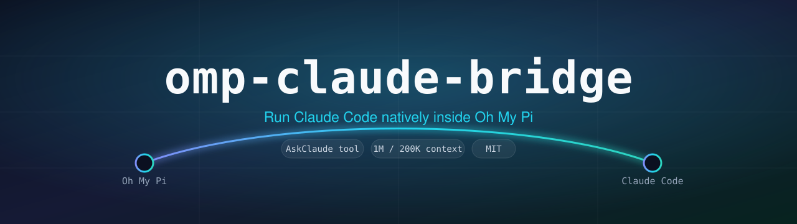

# omp-claude-bridge



An [Oh My Pi](https://github.com/can1357/oh-my-pi) extension that integrates Claude Code through the [Claude Agent SDK](https://github.com/anthropics/claude-agent-sdk-typescript). OMP owns the conversation, tools and compaction; Claude Code supplies the model.

This port incorporates [pi-claude-bridge](https://github.com/elidickinson/pi-claude-bridge) through **2026-10-23**, commit [`6aa276a`](https://github.com/elidickinson/pi-claude-bridge/commit/6aa276a1498e5376363f5c1f8cf04bfcaee38c93). See [port details and migration notes](documentation/upstream-sync-2026-10-23.md).

## Install

Requires **OMP >=18.13.2**, **Bun >=1.4.4**, and a working Claude Code login on the machine running OMP. Validation currently targets OMP 18.13.2.

```bash
omp install https://github.com/DevVig/omp-claude-bridge
```

For a local checkout:

```bash
bun install --frozen-lockfile
omp install /absolute/path/to/omp-claude-bridge
```

For one run, or to inspect the registered models:

```bash
omp --no-extensions -e /absolute/path/to/omp-claude-bridge
omp models claude-bridge --no-extensions -e /absolute/path/to/omp-claude-bridge
```

Select a `claude-bridge/...` entry with `/model`.

## Models and context windows

Models come from OMP's bundled Anthropic catalog, excluding dated snapshot aliases. Family shortcuts such as `opus` choose the newest matching version; exact model ids take precedence over partial matches.

The picker retains this port's `(1M)` / `(200K)` entries. An unsuffixed id follows `provider.contextWindow`; a suffix such as `claude-opus-4-8-200k` explicitly selects a window. Models with only one supported window use that window even when the configured default requests the other one.

Automatic routing follows upstream's **measured Claude Code mappings**, not the catalog's advertised maximum alone. New, unmeasured models default to 200K. The inherited measurements in [diag/CONTEXT-SIZE.md](diag/CONTEXT-SIZE.md) are upstream results, not a claim that every model was measured again for OMP. Explicit 1M selection requests that runtime; availability and billing still depend on your plan.

## Configuration

Global: `~/.omp/agent/claude-bridge.json`, following OMP's active profile and agent-directory override. Project: `.omp/claude-bridge.json`, merged over global config.

```json
{
  "provider": {
    "plan": "pro",
    "contextWindow": "auto",
    "longContextExtraUsage": false,
    "strictMcpConfig": true,
    "autoMemoryEnabled": false
  },
  "askClaude": { "enabled": false }
}
```

| Provider setting | Default | Behavior |
| --- | --- | --- |
| `plan` | `"pro"` | `"max"` enables the measured Max-specific automatic 1M policy. |
| `contextWindow` | `"auto"` | Default picker window: `"auto"`, `"1m"`, or `"200k"`. Supported alternatives remain selectable. |
| `longContextExtraUsage` | `false` | Opt into measured 1M mappings requiring Extra Usage. |
| `forceTwoHundredK` | `[]` | Bare model ids pinned to 200K; removes their 1M entries and rejects explicit 1M requests. |
| `strictMcpConfig` | `true` | Ignore Claude Code's filesystem MCP configuration. Cloud MCP is always disabled for bridge queries. |
| `autoMemoryEnabled` | `false` | Enable Claude Code's own auto-memory system. |
| `pathToClaudeCodeExecutable` | SDK default | Override the Claude Code binary path. |

OMP's rendered prompt blocks are preserved, including loaded project rules, skills, custom prompts, append text and extension instructions. The bridge uses what OMP actually loaded; it does not rediscover files. OMP's `--no-context-files` and `--no-skills` control those sources. Claude Code's own CLAUDE.md/AGENTS.md discovery is suppressed to avoid duplication.

`provider.appendSystemPrompt` and `provider.settingSources` from older releases have been replaced by this prompt handling; see the migration notes.

## AskClaude

The legacy delegation tool is **disabled by default and deprecated** upstream. Set `askClaude.enabled: true` to enable it explicitly. Settings remain `name`, `label`, `description`, `defaultMode` (`read`, `none`, `full`), `defaultIsolated`, `allowFullMode`, and `appendSkills`.

The default mode is `read`. `allowFullMode: false` removes and rejects `full`. Full mode lets Claude Code run its own tools with permissions bypassed.

## Behavior and limitations

- The provider exposes OMP tools over MCP. Claude Code's native tools are disabled; OMP executes the calls and applies its tool policy. Bash without a timeout gets a 120-second default.
- The updated upstream machinery pairs tools by id, preserves images and carried attachments, and handles parallel results, steering, aborts and history rewrites.
- OMP and other extensions retain compaction and branch-summary ownership. Their model requests use isolated Claude Code summaries; the live mirror changes after OMP commits the history rewrite.
- Rebuilds resend history and can lose prompt-cache reuse. Aborts, compaction, tree navigation and errors can trigger a rebuild.
- Changed system instructions can remain frozen in a resumed Claude Code session until a rebuild. Start a new session when changes must apply immediately.
- Exported `ANTHROPIC_BASE_URL`, `ANTHROPIC_API_KEY`, and `ANTHROPIC_AUTH_TOKEN` also affect the Claude Code child. Check these when a subscription login unexpectedly uses a gateway or API key.
- Login, SDK availability and subscription limits are requirements on the server running OMP. Mobile clients continue to access OMP through their usual adapter.

## Debugging

```bash
CLAUDE_BRIDGE_DEBUG=1 omp
```

Logs follow OMP's agent directory: `claude-bridge.log`, `claude-bridge-diag.log`, and `cc-cli-logs/`. `CLAUDE_BRIDGE_DEBUG_PATH` overrides the main log. Logs may contain prompts and code; inspect them before sharing.

Run JavaScript diagnostics with Bun when they import OMP. Historical `diag/` reports describe their original Pi runs; the port notes identify checks performed against OMP.

## Development

```bash
bun install --frozen-lockfile
bun run typecheck
bun run test
bun run test:smoke
```

Unit suites run in isolated Bun processes with temporary agent and Claude directories. They include real OMP compaction, branch navigation, prompt construction and concurrent-session routing with a controlled SDK. The smoke launches the actual OMP CLI and checks provider selection, instruction forwarding and response delivery. These checks make no Claude API requests.

The `tests/int-*` scenarios exercise real Claude Code: they require authentication, consume usage and write Claude session state. The RPC harness uses the local OMP dependency, overridable with `OMP_BIN`.

## Credits and license

Original bridge by [Eli Dickinson](https://github.com/elidickinson/pi-claude-bridge), based on [Prateek Sunal's bridge](https://github.com/prateekmedia/claude-agent-sdk-pi). OMP port and context-window controls by [Jonathan Borgwing](https://github.com/DevVig). MIT; see [LICENSE](LICENSE) and [NOTICE](NOTICE).
